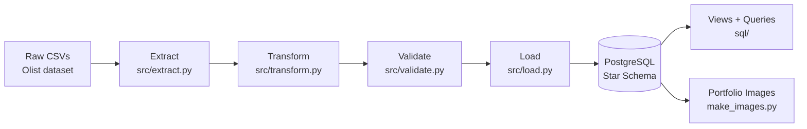
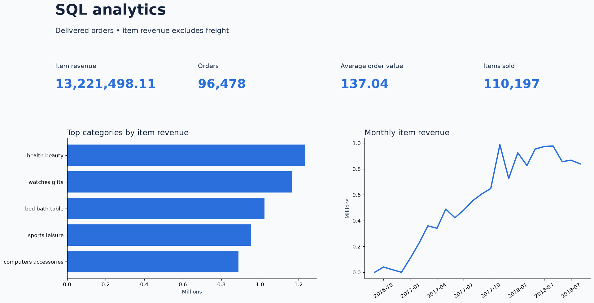

# E-commerce Data Pipeline

A batch ETL pipeline that extracts Olist Brazilian e-commerce CSVs, validates and transforms them, and loads a PostgreSQL star schema with idempotent inserts, analytical views, and verified SQL queries — built to demonstrate core Data Engineering skills for junior roles.


## Why This Exists

Most portfolio projects stop at a Jupyter notebook. Hiring managers for Junior Data Engineer and Analytics Engineer roles want to see: reproducible pipelines, idempotent warehouse loads, data quality gates, dimensional modeling, and SQL that answers business questions. This project delivers all of that in a single, runnable codebase — no cloud account required.

## What It Does

- **Extracts** 6 Olist CSV files with required-column contracts
- **Transforms** with per-source quality counts (duplicates, rejected, excluded, cleaned)
- **Validates** keys, references, ranges, and item-total arithmetic before any DB write
- **Loads** a star schema (`dim_customers`, `dim_products`, `dim_date`, `fact_orders`, `fact_payments`) in one transaction using `INSERT ... ON CONFLICT DO NOTHING` for idempotency
- **Exposes** 3 analytical views + 9 queries for sales reporting
- **Generates** portfolio diagrams from the loaded warehouse



## Data

| Source | Files | License | Grain |
|--------|-------|---------|-------|
| Olist Brazilian E-Commerce (Kaggle) | 6 CSVs | CC BY-NC-SA 4.0 | Order item / payment |

**Key quality rules** (enforced in `src/validate.py`):
- Business keys are 32-char hex; duplicates → rejected
- `total_amount == quantity * unit_price` per item
- Facts reference existing dimension keys (FK integrity)
- Non-delivered orders + children → excluded (not rejected)
- Every source logs: `input = duplicates + rejected + excluded + cleaned`

## Stack

| Layer | Technology | Why |
|-------|------------|-----|
| Language | Python 3.11+ | Standard for DE/ML, rich data ecosystem |
| Dataframes | pandas | In-memory transforms, CSV handling |
| Database | PostgreSQL 16+ via psycopg 3 | Production-grade, native `ON CONFLICT`, arrays, JSON |
| Orchestration | None (manual batch) | Keeps focus on pipeline mechanics; Airflow/Dagster noted in roadmap |
| Testing | unittest + pytest | Zero extra deps for core tests; pytest for CI |
| Lint/Format | Ruff | Fast, replaces flake8+isort+black |
| Pre-commit | ruff + standard hooks | Enforces style before commit |
| Diagrams | matplotlib (Agg backend) | Generates portfolio images from live DB |

## Project Tree

```text
ecommerce-data-pipeline/
├── src/
│   ├── extract.py            # CSV loading & column contracts
│   ├── transform.py          # Cleaning, normalization, quality counts
│   ├── validate.py           # Key/ref/range checks + reconciliation
│   ├── load.py               # Transactional idempotent inserts
│   ├── pipeline.py           # Entrypoint, logging, .env loading
│   └── make_images.py        # DB-backed portfolio charts
├── sql/
│   ├── create_tables.sql     # Tables, PK/FK, indexes, checks
│   ├── views.sql             # monthly_sales_summary, customer_order_summary, product_sales_summary
│   └── analytics_queries.sql # 9 business queries
├── tests/
│   ├── sample_data.py        # Synthetic rows for unit tests
│   ├── test_pipeline.py      # Extract/transform/validate (16 tests)
│   └── test_load.py          # PG integration (4 tests, needs TEST_DATABASE_URL)
├── docs/
│   └── run_results.md        # Verified full-run numbers and SQL outputs
├── data/raw/                 # Downloaded CSVs (gitignored)
├── images/                   # Architecture diagram
├── portfolio/                # Pipeline overview, data model, SQL analytics
├── logs/                     # Run logs (gitignored)
├── .env.example              # DB_* template
├── requirements.txt
├── pyproject.toml            # Ruff, pytest, coverage config
├── .pre-commit-config.yaml
├── LICENSE
└── README.md
```

## Run

**Prereqs:** Python 3.11+, PostgreSQL 16+ (local or Docker), `createdb`/`psql` in PATH.

```bash
# 1. Clone & venv
git clone https://github.com/abosameh522/ecommerce-data-pipeline.git
cd ecommerce-data-pipeline
python -m venv .venv && source .venv/bin/activate
pip install -r requirements.txt

# 2. Data (manual download from Kaggle)
curl -fL --retry 2 "https://www.kaggle.com/api/v1/datasets/download/olistbr/brazilian-ecommerce" -o olist.zip
unzip -j olist.zip -d data/raw

# 3. Configure
cp .env.example .env
# Edit .env with your PostgreSQL credentials

# 4. Database (Option A: Docker Compose - recommended)
docker compose up -d
# wait for healthy status

#    (Option B: Existing PG)
set -a; source .env; set +a
export PGHOST="$DB_HOST" PGPORT="$DB_PORT" PGUSER="$DB_USER" PGPASSWORD="$DB_PASSWORD"
createdb "$DB_NAME"

# 5. Run pipeline
python src/pipeline.py

# 6. Query
psql -X -v ON_ERROR_STOP=1 -d "$DB_NAME" -f sql/analytics_queries.sql

# 7. Idempotency check (should insert 0 rows)
python src/pipeline.py

# 8. Regenerate portfolio images
python src/make_images.py
```

**UNVERIFIED:** The `curl` download requires a Kaggle account; if it fails, download manually from the Kaggle UI and unzip to `data/raw/`. The Docker Compose path was tested on Linux; macOS/Windows may need `host.docker.internal` adjustments.

## Results

| Metric | Value | Source |
|--------|-------|--------|
| Delivered orders loaded | 96,478 | `docs/run_results.md:26` |
| Order items (fact_orders) | 110,197 | `docs/run_results.md:40` |
| Payment records (fact_payments) | 100,756 | `docs/run_results.md:41` |
| Item revenue (BRL) | 13,221,498.11 | `docs/run_results.md:54` |
| Avg item value per order (BRL) | 137.04 | `docs/run_results.md:55` |
| Top category | health_beauty | `docs/run_results.md:56` |
| Top category revenue (BRL) | 1,233,131.72 | `docs/run_results.md:57` |
| Pipeline runtime (full dataset) | TODO(ahmed) | run locally and record |
| Database size on disk | TODO(ahmed) | run locally and record |

> Verified on Linux, Python 3.14.7, PostgreSQL 18.6. See `docs/run_results.md` for full reconciliation tables and SQL query outputs.



## Learned

- **Idempotent warehouse loads** are non-negotiable: `ON CONFLICT DO NOTHING` on natural keys + surrogate PKs makes reruns safe and auditable.
- **Validation before load** catches garbage early and keeps DB errors out of the critical path — distinguish *rejected* (bad data) from *excluded* (out of scope).
- **Separate fact grains** prevent double-counting: items and payments at different grains must be aggregated to order grain before joining on money.
- **Reconciled counts** (`input = dup + rej + exc + clean`) survive partial failures and make data quality visible.
- **Integer date keys** (`YYYYMMDD`) simplify partitioning and range scans vs. `DATE` foreign keys.

## Limitations

- **Insert-only**: no upsert for corrected source rows; repeat load skips known keys.
- **No incremental watermark**: full scan every run; `max(date_key)` logic is a TODO.
- **Sparse date dimension**: only observed dates exist, so monthly trends have gaps.
- **No orchestration**: manual run; Airflow/Dagster DAGs are roadmap items.
- **Single-writer insert counts**: before/after table counts assume no concurrent loads.
- **In-memory pandas**: not suited for >100M rows without chunking or Polars/DuckDB.

## Roadmap

- [ ] Incremental extract via `max(date_key)` watermark + `updated_at` on source
- [ ] Upsert path with `updated_at` so corrected rows propagate
- [ ] Rejected-rows report (CSV/Parquet) with per-record reason codes
- [ ] Continuous date dimension for gap-free trend reporting
- [ ] Airflow/Dagster DAG with task groups, retries, SLAs
- [ ] Great Expectations checkpoints in `validate.py`
- [ ] dbt project for SQL layer (models, tests, contracts, lineage)
- [ ] CI: Testcontainers for Postgres integration tests on every PR

## License

MIT — see [LICENSE](LICENSE).

## Contact

Ahmed Sameh — Data Engineer & Analyst  
GitHub: [@abosameh522](https://github.com/abosameh522)  
Open to Junior Data Engineer / Analytics Engineer roles (remote, Egypt-based).  
Availability: now (part-time) / full-time after graduation 2027.  
No visa sponsorship needed for remote roles.